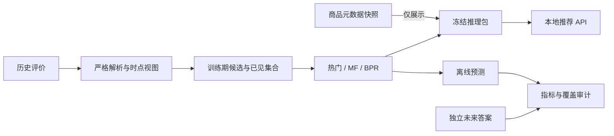

# MemRecAgent

**面向长期偏好记忆研究的可复现商品推荐系统。**

MemRecAgent 将推荐模型、商品事实与用户记忆分开建模，目标是回答：在相同模型、候选池和预算下，长期偏好记忆能否改善推荐？

现已接通既有乐器目录的可信品类、精确商品实体及4871个唯一完整标题别名，支持跨会话分析、检索、提交和排名。前期4个活跃画像及2个冷用户的24组固定响应检查仅验证实际BPR/回退路径；后续真实语言结果见下，独立效用仍未证明。见[同域接入报告](docs/reports/INSTRUMENT-DOMAIN-INTEGRATION-REPORT.md)与[完整标题映射](docs/reports/INSTRUMENT-TITLE-ALIASES-REPORT.md)。

同域真实语言验收已完成126次调用：单次/双阶段状态均36/42、严格均35/42，双阶段token约2.13倍，未见状态收益。4活跃画像实际使用BPR、2冷用户回退；同域语言接线已运行，仍无独立效用标签，见[结果与失败](docs/reports/INSTRUMENT-LANGUAGE-EVALUATION-REPORT.md)。

预留测试已按270次授权及后续“仅续跑未发送故事”确认完成本次执行，共260次尝试、1104358已报token、2次用量未知；原传输失败保留。
主6任务/4场景族的NDCG@3为单次.2226、双阶段.3309，差值区间跨0，双阶段已报token约2.29倍，尚无稳定收益证明。
另发现用户要1款而冻结评分K=3的协议错位，主指标保持，@1只作事后诊断；见[完整报告](docs/reports/HOLDOUT-EVALUATION-REPORT.md)。

**当前未证明记忆增强带来收益。** 新系统对照的10个暂定标签开发任务/5个场景族中，原结构化记忆基准NDCG@3为0.513，完整历史LLM为0.796，字符检索LLM为0.786；后两组30次真实调用、45,521token。原基准落后且约束违反更多，不能称优于传统记忆。比较的是原冻结版本，不是修复后工作树的最终效果；合成/小样本、非Mem0复现，见[系统对照](docs/evaluation.md#完整历史与字符检索系统基线)。

外部AI合成数据已按明确政策派生并按场景族划分，完整集60故事360轮、30任务240商品。
实际空库语言分析到四组排名的开发集首测已完成，267调用、1091492tokens；
双阶段相对单次推荐差值区间跨0、token约2.13倍，未显示收益。14任务参考标签需复核。
没有匹配行为画像，算法臂实际冷回退，不能据此宣称MF收益，见[评测说明](docs/evaluation.md#外部合成集验收)。

已提供四组离线消融及同一次实际请求的 Pi 只读对照，固定人物、预算、历史和分析结果。新两段合成故事的真实 Pi 四组回答 8/8，28 次调用、47,925 token；本人偏好跨会话、他人仅会话、分支不改磁盘均符合机制预期。算法组实际冷回退，不能证明 MF 或真实用户收益；见本地报告 `docs/reports/PI-FOUR-GROUP-COMPARISON-REPORT.md` 和[评测](docs/evaluation.md#pi同请求四组机制首测)。

统一写入评测已提供32段、192步版本化合成语料及实际提交/重启/错误传播评分，开发与预留测试各96步。作者已知标签，尚非独立盲测；默认零调用，真实模式需要环境Key和显式预算。开发集首测共285次模型调用：单次严格71/96、双阶段68/96，完整故事均4/16；双阶段token约2.15倍，未显示收益。原32段语料测试集尚未运行；外部派生预留集已执行并在失败保留下续跑，固定客户端另作工程验证，见[写入评测](docs/evaluation.md#统一写入与跨会话评分)。

结构化本次硬约束已接入实际排名与四组工具：预算、重量等数值及屏幕/护眼条件，未知属性不当满足，超预算商品不能因品牌偏好入选。长期属性已接schema4语言候选、受控保存/修订/撤销及跨会话硬过滤，与品牌共用一次原子发布；他人属性只留会话。本次覆盖或明确解除不改磁盘。新6步/3会话合成真实模型故事按冻结检查6/6，24次调用/59834tokens，验证保存、当前覆盖、结束及撤销后读取；原2/5失败保留。这是冷启动机制验收，尚非四组效用或真实用户收益，见[架构](docs/architecture.md#类型化本次硬约束)。

当前版本提供历史交互处理、推荐评测和本地API，并已接入显式live聊天入口：Pi主循环调用独立MemoryAnalyst，在证据与人物守卫下保存本人偏好，再结合候选评分推荐。本人长期记忆可跨会话，亲属偏好只留当前会话。有限合成自然语言闭环已验证；默认只读提取入口保持，真实用户可靠性、四组收益和修复后最终效用验收仍待完成。

早期Phase3验收与后续失败均保留在[评测记录](docs/evaluation.md#商品选项与维持旧偏好-request-lifecycle-v1)，不能替代当前版本的最终验收。

[当前状态与待完成事项](docs/STATUS.md) · [实验报告索引](docs/reports/README.md) · [快速开始](#快速开始) · [实验结果](#实验结果) · [架构](docs/architecture.md) · [复现指南](docs/reproduction.md) · [API](docs/api.md)

## 已实现能力

- **Pi对话运行时**：实际模型—工具循环连接持续Python会话；独立MemoryAnalyst只读提案，Python核验原文、人物、时间及提交权限。显式live聊天入口每轮最多4次调用，普通问答与推荐均经过状态守卫；默认只读提取CLI另行保留。[运行方法](docs/reproduction.md#显式live本地聊天)
- **本人长期与他人会话记忆**：本人偏好跨会话保存，他人稳定喜好只在会话内；咨询/比较/提及不自动等于喜好，明确歧义先澄清。支持修订、撤销及可选最大年龄；语义识别仍会失败，工程守卫不等于自然语言准确率。[架构](docs/architecture.md)
- **类型化属性与当前任务**：预算、重量、续航、尺寸等硬条件先过滤；未知/未来规格不当满足。长期硬软属性可保存/修订/撤销，本次条件不写盘，start/end/换人界定选购任务。[属性说明](docs/architecture.md#类型化本次硬约束)
- **软属性实际排序**：满足/违背/未知分别+1/−1/0，按属性平均；与品牌信号复用现有0.75权重。支持独立关闭软属性评分，当前要求不与同轮保存重复计分；权重尚未证明最优。[评分规则](docs/architecture.md#软属性排序)
- **仅本次软偏好**：当前选购任务内沿用，可暂时忽略某属性软偏好；不取消硬预算，结束/换人/重启清除，四组共用。[验证范围](docs/reports/REQUEST-SOFT-ATTRIBUTES-REPORT.md)
- **可信实体别名**：新空命名空间绑定固定、有来源的整实体别名表，原文证据不改，修订/检索/排序/反馈/删除共用规范键；未知不猜，不自动迁移旧库。[配置方法](docs/reproduction.md#配置可信实体别名)
- **可解释程序排名**：热门、MF、BPR与显式冷用户回退；记忆排除先过滤，软偏好进入完整候选评分。商品事实、分数及来源由工具返回，生产LLM须保持精确商品ID顺序；历史目录不冒充实时价格规格。[推荐接口](docs/api.md)
- **同请求四组消融**：共享实际分析、人物、当前约束和候选，仅切换长期读取与算法信号；保留实际路由，有效用户向量缺失时明确记为回退。已有真实Pi冷启动闭环及真实活跃画像结构化反事实控制，尚无同品类语言画像效用证明。[实验结果](docs/evaluation.md)
- **显式评分数量协议**：后续实验可选`--scoring-mode request`，按原请求数量事前确定四组共同K，失败不缩分母；默认fixed保留旧口径，原260调用主结果不重标，见[运行方法](docs/reproduction.md#按请求数量选择评分k下一版实验)。
- **系统对照与敏感度**：完整历史LLM、字符TF-IDF检索LLM、共享草案可见/不可见对照，以及固定开发状态的2归一化×5权重扫描。保留负结果与失败分母，不称Mem0复现或证明二次分析有收益。[评测协议](docs/evaluation.md)
- **可信展示反馈**：实际显示后登记精确商品/品牌，显式聊天命令支持持久/本次屏蔽与撤销；商品反馈不扩大到品牌，当前反馈四组共享。隐式点击/购买权重学习尚未实现。[反馈边界](docs/architecture.md#可信目标反馈接口)
- **本地管理与用途控制**：查看当前/历史，纠正保留版本；统一删除品牌/属性/反馈，删除水位阻止旧证据重放，中断阻读并可显式恢复。个性化、长期更新与广告用途分开，广告默认拒绝。[管理方法](docs/reproduction.md#本地记忆管理)
- **回执与隐私守卫**：删除/撤权/任务变更使旧结果失效，摘要墓碑防重复收费/写入，fresh失败释放本实例会话及请求引用；不承诺外部副本、日志或物理内存擦除。[运行时](docs/architecture.md#双向对话运行时)
- **可复现数据与推理**：父商品ID归一、冻结时间前缀、完整seen过滤；模型/词表/历史/目录以SHA256核验，请求不训练或下载。标签不传入分析/排名，冷用户与候选外目标保留计数。

当前工程检查与研究证据分别记录。最新功能检查见[本次软偏好报告](docs/reports/REQUEST-SOFT-ATTRIBUTES-REPORT.md)；
一次整体独立审查已完成，2项Important由作者回归修复、1项Minor暂缓，未二次复审；外部预留测试已在原失败保留下完成获批续跑，基础设施缺失、数量评测错位和真实效用缺口仍保留。没有真实用户数据，不能声称提升真实用户满意度。完整要求与缺口见[验收预检](docs/reports/FINAL-ACCEPTANCE-PREFLIGHT.md)。

## 快速开始

需要 Python 3.12、[uv](https://docs.astral.sh/uv/) 和 Git。当前真实实验在 macOS arm64 / CPU 上运行；其他平台尚未实测。

```bash
git clone https://github.com/Xxly959/MemRecAgent.git
cd MemRecAgent
uv sync --locked --extra ml --extra api

# 测试无需下载真实数据，也不会触发完整模型训练。
uv run --locked --extra ml --extra api pytest
uv run --locked --extra ml --extra api ruff check .
uv run --locked --extra ml --extra api ruff format --check .
```

仓库不附带数据集或预训练权重。首次构建商品服务，请按[复现指南](docs/reproduction.md)完成获取、处理、评测和推理包导出。获取脚本默认只显示计划，显式 `--fetch` 才下载。

### 启动推荐 API

将 `BUNDLE_DIR` 替换为自己导出的目录：

```bash
BUNDLE_DIR=artifacts/product_bundles/<run-id>
uv run --locked --extra ml --extra api python scripts/serve_products.py --bundle "$BUNDLE_DIR"
```

服务只监听 `127.0.0.1:8000`。访问 `http://127.0.0.1:8000/docs` 可查看交互式接口文档。

先通过 `GET /health` 获取 `bundle_id`，再请求：

```http
POST /recommendations
Content-Type: application/json

{
  "user_id": "demo-user",
  "bundle_id": "从 /health 获取的版本",
  "strategy": "bpr_cold_popularity",
  "k": 10
}
```

策略可选 `popularity`、`mf`、`bpr`、`bpr_cold_popularity`。响应包含实际策略、原始得分、已见过滤计数、商品标题/类别及快照来源；未知事实保持未知。详细字段和错误码见 [API 文档](docs/api.md)。

### 运行偏好提取预览

```bash
# 默认只检查24条合成案例并展示计划，不读取Key、不调用模型。
uv run --locked --extra ml --extra api python scripts/evaluate_memory_extraction.py
```

需要真实评测时，在运行进程中配置本机 `DEEPSEEK_API_KEY` 后加 `--live`。使用 `deepseek-flash`、官方 OpenAI 兼容协议，最多24次、无自动重试；不会修改真实记忆。结果保存在本地忽略的 artifacts 目录，不能把凭证加入 Git。

## 实验结果

Amazon Reviews 2023 **Musical_Instruments**，固定用户哈希桶得到 179,630 条事件、106,129 位用户；候选白名单为训练期选出的 5,000 个父商品。

按 UTC 时间切分：2022 年以前训练、2022 年上半年验证、下半年测试。评分 ≥ 4 为正向，K=10；各有正例用户等权平均。MF/BPR 使用相同 16 维、seed=42 和有限验证选轮预算。

| 模型 / 策略 | Recall@10 | NDCG@10 |
| --- | ---: | ---: |
| 热门 | 0.007910 | 0.004545 |
| MF | 0.000824 | 0.000539 |
| BPR-MF | 0.000249 | 0.000118 |
| BPR + 无历史用户热门兜底 | 0.006215 | 0.003641 |

**当前固定配置下，MF/BPR 均未超过热门。** 测试有效用户 5,355 人，其中 3,778 人没有任何历史；7,315 个正向目标中 5,040 个位于候选白名单外，仍保留在分母。这些结果反映当前稀疏人群与候选限制，不能外推为全类目效果或模型最优性能。

实验为单种子，测试在热门基线阶段已查看，未据测试追加调参。历史评分是交互可用时间的代理；商品元数据仅作展示快照。完整协议、资源记录和 MovieLens 结果见[评测说明](docs/evaluation.md)。

语言提取首轮24条合成案例：原始严格语义通过13/24。修复转换层问题后，对相同真实响应离线重放为14/24，新增API调用为0；仍有2条提取失败、1条必要澄清未完成和1条错误长期提案。当前不启用自动写入，不能据此声称真实用户效果或记忆推荐增益。协议和指标边界见[评测说明](docs/evaluation.md)。

另一次多轮评测为3段×6基础步、20次真实DeepSeek请求：严格步骤14/18、确认完整契约1/2、整段严格0/3。当前长期/活跃状态均18/18符合规则参考；实际7条长期写入中未观察到错误，4次处理失败仍计失败。参考标签为助手按规则编写，结果不代表真实用户泛化效果；提取与确认契约仍需改进。

后续契约修复分别运行一次旧集回归与新合成集首测，各20次请求：两套均为严格17/18、确认2/2、整段2/3，未再出现上述格式失败。新集额外核对请求目标和当前态度，投影18/18，但仍因无请求/无态度的多人提及触发多余澄清而失败；完整Phase3尚未通过。新集与旧集评分不同，不能合并为准确率；开发回归使用35835tokens，高于上轮25005，不称同预算提升。详见[评测说明](docs/evaluation.md#2026-10-21契约修复与新合成首测)。

最新澄清触发校准中，v2开发回归与v3新合成首测各20次请求，分别达到严格18/18、整段3/3、确认2/2。新集5个无操作背景未多余追问，4个真实歧义仍被拦截，混合未完成表达未部分写入。判断仍依赖模型，保留宿主保守校验；该次校准时原24例尚未重测，后续当前版本回归见下段；真实自动写入保持关闭。见[澄清评测](docs/evaluation.md#2026-10-21澄清触发校准)。


原24例当前版本单次开发回归：24次真实DeepSeek请求，严格18/24，提取失败3、必要澄清未完成1、错误长期提案1。未修改提示或标签追分；同响应离线宿主核查中N2错误neutral被过滤，O3人物引用错位却仍被接受，说明“无错误长期内容”不等于“推荐对象正确”。六例失败和原13/24、重放14/24均保留。详见[评测说明](docs/evaluation.md#原24例当前版本开发回归)。


## 架构



采用 Python 模块化单体，NumPy/PyTorch 负责算法，FastAPI/Pydantic/Uvicorn 负责本地 HTTP。推荐引擎不依赖 LLM 或记忆存储，便于后续进行控制变量实验。

```text
src/memrecagent/   # 数据适配、模型、采样、评测、推理与 API
scripts/          # 数据获取、实验、包导出及服务入口
tests/            # 单元、协议、合成 CLI 与 HTTP 契约测试
docs/             # 架构、数据、评测、复现与 API 文档
pyproject.toml    # Python 包及可选依赖
uv.lock           # 锁定环境
```

## 后续方向

- [x] 基础推荐模型与 MovieLens 时间评测。
- [x] 真实商品数据、统一协议和冻结本地 API。
- [x] 本人偏好证据持久化、显式修订、会话对象隔离及结构化请求澄清策略。
- [x] 自然语言提取与只读提案预览、冻结合成集首轮评测。
- [x] 本地查看、明确纠正、按实体删除及删除后的旧提案重放防护。
- [x] 宿主票据、原子批量提交及结构化主体/范围确认的程序闭环。
- [x] 可选记忆年龄、只读自然语言确认候选及首轮合成多轮实测。
- [x] 提取/确认格式提示修复、新合成套件选择与请求/态度语义评分。
- [x] 澄清触发规则校准及无操作/真实未完整表达的合成对照验证。
- [x] **Phase3 原范围交付**：本地记忆及显式分析角色交付，有限合成验收完成；历史语义失败仍保留，不代表真实用户可靠性。
- [ ] **Phase4 记忆增强排序**：完整候选融合与Pi实际对话已接入；四组离线基础设施已实现，自动记忆贡献、门控与衰减收益仍待验证。
- [ ] **Phase5 公众评价**：增加时间一致的评价特征并单独比较。
- [ ] **Phase6 工程化评测**：端到端集成、追踪、故障处理；候选研究包括记忆角色与提交策略的多组架构/成本对照。

当前已有记忆增强排序和有限机制探针；正式自动记忆收益消融尚未完成。结构化策略测试、小规模合成语义评测和真实用户结论分别报告，上述待办不代表已实现能力。

## 数据与使用边界

数据来源：[Amazon Reviews 2023](https://amazon-reviews-2023.github.io/main.html)、[MovieLens 100K](https://grouplens.org/datasets/movielens/100k/)。请遵守各发布方使用条件；公开可下载不等于获得再分发或商业使用许可。仓库仅包含代码和汇总说明，不上传原始评论、真实用户标识、商品图片、模型或预测日志。

API 返回的是带版本的历史商品快照，不提供实时价格、库存或购买概率，也没有公网认证与生产部署配置。数据版本、哈希和字段约束见[数据说明](docs/data.md)。
