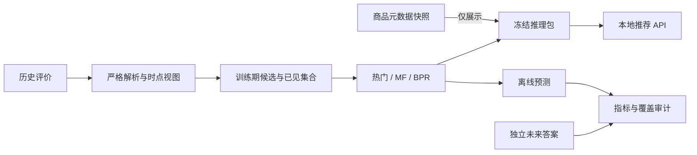

# MemRecAgent

**面向长期偏好记忆研究的可复现商品推荐系统。**

MemRecAgent 将推荐模型、商品事实与用户记忆分开建模，目标是回答：在相同模型、候选池和预算下，长期偏好记忆能否改善推荐？

当前版本提供从历史交互处理、模型评测到本地推荐 API 的完整链路，支持 MovieLens 100K 与 Amazon Reviews 2023。长期记忆与对话 Agent 是后续工作，尚未实现。

[快速开始](#快速开始) · [实验结果](#实验结果) · [架构](docs/architecture.md) · [复现指南](docs/reproduction.md) · [API](docs/api.md)

## 已实现能力

- **推荐基线**：热门、ItemCF、评分矩阵分解（MF）和 BPR-MF；商品 API 支持热门、MF、BPR 及显式冷用户兜底。
- **时间一致的数据链路**：父商品 ID 归一、历史前缀去重、冲突拒绝、训练期候选选择及完整已见过滤。
- **可核验评测**：Recall、NDCG、Precision、HR；候选外正例保留分母，冷用户和无正例用户分别计数。
- **受控资源使用**：流式处理原始 JSONL，BPR 按需采样，避免预存用户 × 商品负样本池。
- **冻结推理服务**：模型、词表、历史与目录打包，使用 SHA256 校验文件与版本；请求不下载数据、不训练模型。
- **复现记录**：数据版本、文件摘要、源码快照、随机种子、验证选轮、权重和逐用户预测分别保存。

## 快速开始

需要 Python 3.12、[uv](https://docs.astral.sh/uv/) 和 Git。当前真实实验在 macOS arm64 / CPU 上运行；其他平台尚未实测。

```bash
git clone https://github.com/Xxly959/MemRecAgent.git
cd MemRecAgent
uv sync --locked --extra ml --extra api

# 测试无需下载真实数据，也不会触发完整模型训练。
uv run --locked --extra ml --extra api pytest
uv run --locked --extra ml --extra api ruff check .
uv run --locked --extra ml --extra api ruff format --check .
```

仓库不附带数据集或预训练权重。首次构建商品服务，请按[复现指南](docs/reproduction.md)完成获取、处理、评测和推理包导出。获取脚本默认只显示计划，显式 `--fetch` 才下载。

### 启动推荐 API

将 `BUNDLE_DIR` 替换为自己导出的目录：

```bash
BUNDLE_DIR=artifacts/product_bundles/<run-id>
uv run --locked --extra ml --extra api python scripts/serve_products.py --bundle "$BUNDLE_DIR"
```

服务只监听 `127.0.0.1:8000`。访问 `http://127.0.0.1:8000/docs` 可查看交互式接口文档。

先通过 `GET /health` 获取 `bundle_id`，再请求：

```http
POST /recommendations
Content-Type: application/json

{
  "user_id": "demo-user",
  "bundle_id": "从 /health 获取的版本",
  "strategy": "bpr_cold_popularity",
  "k": 10
}
```

策略可选 `popularity`、`mf`、`bpr`、`bpr_cold_popularity`。响应包含实际策略、原始得分、已见过滤计数、商品标题/类别及快照来源；未知事实保持未知。详细字段和错误码见 [API 文档](docs/api.md)。

## 实验结果

Amazon Reviews 2023 **Musical_Instruments**，固定用户哈希桶得到 179,630 条事件、106,129 位用户；候选白名单为训练期选出的 5,000 个父商品。

按 UTC 时间切分：2022 年以前训练、2022 年上半年验证、下半年测试。评分 ≥ 4 为正向，K=10；各有正例用户等权平均。MF/BPR 使用相同 16 维、seed=42 和有限验证选轮预算。

| 模型 / 策略 | Recall@10 | NDCG@10 |
| --- | ---: | ---: |
| 热门 | 0.007910 | 0.004545 |
| MF | 0.000824 | 0.000539 |
| BPR-MF | 0.000249 | 0.000118 |
| BPR + 无历史用户热门兜底 | 0.006215 | 0.003641 |

**当前固定配置下，MF/BPR 均未超过热门。** 测试有效用户 5,355 人，其中 3,778 人没有任何历史；7,315 个正向目标中 5,040 个位于候选白名单外，仍保留在分母。这些结果反映当前稀疏人群与候选限制，不能外推为全类目效果或模型最优性能。

实验为单种子，测试在热门基线阶段已查看，未据测试追加调参。历史评分是交互可用时间的代理；商品元数据仅作展示快照。完整协议、资源记录和 MovieLens 结果见[评测说明](docs/evaluation.md)。

## 架构



采用 Python 模块化单体，NumPy/PyTorch 负责算法，FastAPI/Pydantic/Uvicorn 负责本地 HTTP。推荐引擎不依赖 LLM 或记忆存储，便于后续进行控制变量实验。

```text
src/memrecagent/   # 数据适配、模型、采样、评测、推理与 API
scripts/          # 数据获取、实验、包导出及服务入口
tests/            # 单元、协议、合成 CLI 与 HTTP 契约测试
docs/             # 架构、数据、评测、复现与 API 文档
pyproject.toml    # Python 包及可选依赖
uv.lock           # 锁定环境
```

## 后续方向

- [x] 基础推荐模型与 MovieLens 时间评测。
- [x] 真实商品数据、统一协议和冻结本地 API。
- [ ] 带原始证据、时间与范围的偏好记忆，以及纠正、删除和冲突处理。
- [ ] 记忆激活与排序特征，在固定候选/模型/预算下进行开启、关闭与消融对照。
- [ ] 时间一致的公众评价特征与端到端评测。

当前没有长期记忆的效果实验；上述待办不代表已实现能力。

## 数据与使用边界

数据来源：[Amazon Reviews 2023](https://amazon-reviews-2023.github.io/main.html)、[MovieLens 100K](https://grouplens.org/datasets/movielens/100k/)。请遵守各发布方使用条件；公开可下载不等于获得再分发或商业使用许可。仓库仅包含代码和汇总说明，不上传原始评论、真实用户标识、商品图片、模型或预测日志。

API 返回的是带版本的历史商品快照，不提供实时价格、库存或购买概率，也没有公网认证与生产部署配置。数据版本、哈希和字段约束见[数据说明](docs/data.md)。
