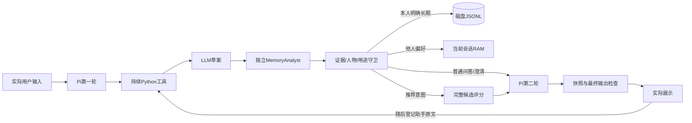
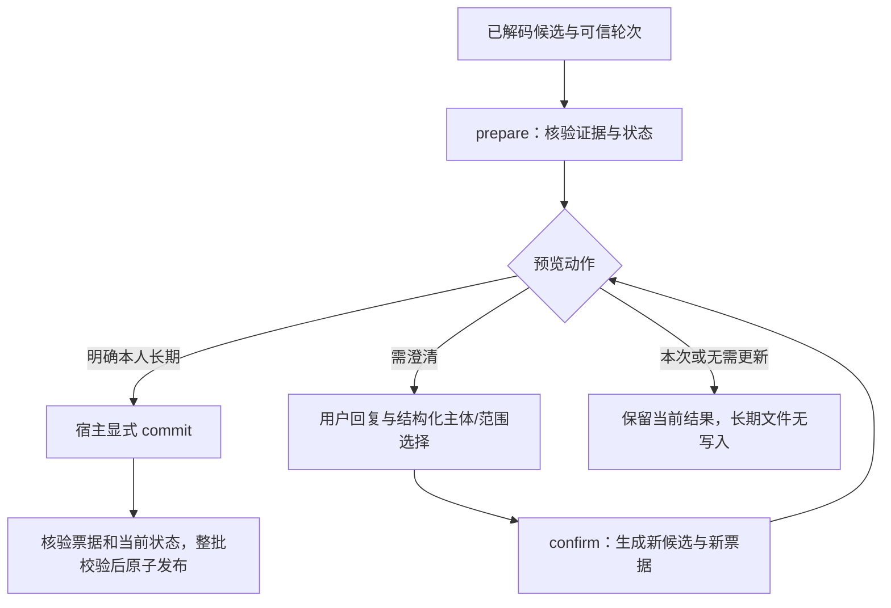

# 系统架构

## 双向对话运行时

显式live `chat-cli`将实际输入绑定给Pi，模型只发空参数conversation_step；同一Python进程持有ConversationProductSession。MemoryAnalyst是项目运行时独立LLM角色，与开发时的代码审查代理不同。以下每轮最多4次供应商调用，主模型与两阶段分析的实际成本分别记录：

主模型前文由Python在fresh核验后回传有界实际历史；不持久重放Pi旧工具消息，以免删除后仍发送旧证据。推荐ID按工具顺序，澄清逐字问题，普通回答允许自然生成但不能将咨询/助手评价当用户偏好。硬盘只放本人长期，亲属上下文不写临时请求文件。失败也缓存回执防重复消费；无回执中断明确unknown，不暗示零消费或零写入。

同请求组件对照新增宿主 request nonce，区别“磁盘状态相同”和“仍是同一个推荐请求”。
`comparison_binding/rank_current/check_comparison` 固定实际 query/预算/人物/历史，
只改变长期读取开关与已有策略；读缓存也重验 nonce/state。Node comparisonConnection 不提交、不分析、
不 observe 反事实，局部关闭不杀共享 owner。Pi 在第二模型发送前及最终发布前均核验，
迟到验证返回还须通过取消/预算检查。仅排名关长期不等于整个 Agent 无记忆。
新真实两故事8组机制首测见本地 PI-FOUR-GROUP-COMPARISON-REPORT.md；全部实际冷热度底座。

普通RPC回执也在读前/读后及发布前同步删除、用途和root绑定；请求指纹仅存规范JSON的SHA256。
状态变化将旧原文/商品回执变成过期墓碑，保留ID/摘要/必要成本及256容量，避免重新收费或删除后重写。
不返回旧记录ID，历史提交状态unknown，不能填空ID冒称历史未写；新请求确未执行才报本次0。
外部失效会清本会话原话/人物/票据/内部宿主及本次属性/旧query，合法自身commit的新结果仍可用。
这是本实例下次读取边界的引用清理，不是跨进程幂等或物理内存擦除，也不能撤回外部caller/记录回调/日志。
见本地RECEIPT-PRIVACY-REPORT.md；系统对照仍使用其既定快照，版本差异不混算为隐私修复的效用。

本次明确数量由宿主`result_count`在已接受recommend动作内处理最新原文，常见句型1至10，
不增加模型输出字段或长期属性；模糊/超限/冲突/否定无替代需完整重述，commit前不部分保存。
数量替换本轮fallback k，下一用户轮重置，比较分支保留同实际k和来源。可选requested_count与
count_evidence仅是本轮输出元信息，长期证据不能混入已识别的数量片段，模型漏推荐标志不能关闭此守卫。
Node校验显式数量及返回数上界，程序说明不足，不放开重排权。此规则不是任意语言理解，
常见工程例及限制见本地RESULT-COUNT-REPORT.md；语义准确率和算法收益没有因本增量获得新证明。

## 记忆融合推荐工具

`agent/src/recommendation-agent.ts`运行实际Pi Agent：空参数`recommend_products`→绑定路径的Python `memory_product_tool`→磁盘JSONL/人物请求策略→完整候选计数或MF/BPR评分→排除及固定软加权→模型有序ID→程序核对和展示。候选实体必须来自绑定同一bundle的显式事实文件，不能由模型猜品牌。非本人/未知受益人走公共热门，不套owner向量及seen。

模型不能选择路径、用户或修改记忆，worker不继承供应商Key。每轮最多2模型/1领域工具，另1发布核验；子进程5秒、整轮30秒，最终发布前对存储、用途revision、请求/事实/包摘要重新核验。原始证据正文不回传，过滤轨迹最多20条并保留完整计数。该工具当前接收可信结构化请求；自然语言MemoryAnalyst和四组验收仍继续，不以这个受约束输出代替自由推荐效果。

## DeepSeek目录工具适配

`agent/src/deepseek-model.ts`通过Pi的OpenAI兼容高级stream接口接固定官方端点和deepseek-flash，实际wire显式thinking disabled；本地model.reasoning元信息不能替代供应商参数。SDK内外重试均0，自定义fetch在发送前拒绝非官方端点/非POST/取消/第3次请求，不跟随重定向。HTTP次数是实际fetch尝试，不是模型逻辑轮数；SDK没有用量则标未报告，不能把默认0当零消耗。未核价格，不使用模型profile零cost估算金额。

默认离线入口保持；独立live-catalog仅允许显式live和冻结合成case ID，Key只读进程环境，不自动扫描凭证文件。真实路径第一请求具名强制catalog_status，第二请求none，不代表自由工具意图识别。模型最终JSON恰含bundle_id/as_of_ms/n_catalog_items，严格解析后逐项核实际health，再由程序渲染；额外字段、重复键、错误数值和代码块直接拒绝。

默认适配器不保模型原文；受控合成入口显式保存正常和工具回答，供应商任意错误原文不写日志。目前length截断只留原因/用量、不留正文，是已记录的非阻塞限制。原三例首测因HTTP400停止（1请求/0工具，后2未执行）；非思考wire缺口作者修复后，另一个不同输入的独立协议探针2HTTP/1工具通过。没有替换原0/3成绩，记忆/排名尚未接本循环。

## Pi正式离线宿主

`agent/src/catalog-agent.ts`实际构造Pi1.4.0的`Agent`，显式串行工具；只暴露空参数`catalog_status`。`bridge-client.ts`用固定argv/shell:false启动已交付Python模块，目录来自可信宿主。正式npm依赖独立锁在agent/package-lock.json，执行路径不依赖spike或源码克隆。

当前CLI使用固定离线streamFn：第一次提出工具，第二次只从真实toolResult生成目录状态说明；Pi循环、子进程和Pythonhealth均真实执行。这是工具链机制验证，尚未接DeepSeek、记忆Hook或推荐排序，不能计为LLM回答质量或记忆收益。

单用户请求独立Agent/进程，默认最多2次模型函数进入和2次工具执行（离线次数不是HTTP数），整体30000ms、单工具5000ms含首次启动。完整工具批次先验名称/空参数/ID及预算，超限整批不执行；工具失败停止，不再让模型修复。独立截止即使遇到不配合abort的模型也让宿主结算，取消后旧回执不交付；进程关闭宽限250ms后强杀，清理时长不计作OS实时保证。仅最终完整回答与实际health生成的状态说明相同才成功，不展示半句。

客户端按字节限制64KiB，严格UTF8、唯一JSON键、精确回执ID与health字段；JS整数要求安全整数，拒绝精度损失。错误只给固定code，stderr丢弃，不默认保存用户原文。当前没有跨请求持久Agent会话、记忆读写、商品排名或广告工具。

## Python只读工具桥接

`agent_bridge.CatalogBridge`绑定已校验的`ProductService`，只暴露`catalog_status({})`并真实调用`health()`。CLI只在启动时通过可信`--bundle`加载一次；请求不接受路径、用户身份、时刻或记忆写入。stdout只有JSONL响应，启动加载失败仅在stderr写`bundle_load_failed`并退出2。

请求恰含`version/id/method/params`，版本为整数1，ID为1—128位ASCII字母、数字或`_.:-`；`params`必须为空对象。响应回带可信ID，成功给出目录版本、历史截止时刻、容量及策略，不代表已经推荐商品。帧按UTF8字节计量，上限65536（不含LF或CRLF）；重复键、非有限常量、无效UTF8拒绝。普通错误回复后继续，超限或缺末尾LF回固定错误码后退出2。无残留EOF退出0，每帧立即flush。

成功回执在当前实例最多保留256个ID；同ID同语义JSON重放独立快照，异参拒绝，满额不淘汰旧回执。后端错误不占成功槽位，可由调用方决定是否重新请求。没有跨重启去重、并发执行或可替换绑定接口，也不抵御恶意同进程代码。

本增量仅完成Python端。Pi宿主下一步负责无shell启动、请求/工具ID关联、单工具5秒与总30秒截止、每轮最多2模型/2工具、取消和迟到回执丢弃；当前桥接不宣称已提供这些客户端保证。模型调用、正式Node宿主、记忆接入和推荐融合仍待后续增量。

MemRecAgent 的研究目标是将带证据的长期偏好与推荐算法结合，并以可复现实验验证收益。当前实现商品推荐底座、本人偏好持久化/管理、结构化策略、可选记忆年龄、只读语言提取/确认候选和宿主票据提交。合成多轮已贯通评测，真实对话可靠性和融合排序尚待完成。

提取请求显式标记最新用户轮次；历史只辅助人物/省略消解。提示示例帮助区分字段级枚举，但不改变严格解码和宿主权限。多轮新验收同时核对初始请求/态度语义、动作、人物、真实状态和写入；合法JSON或正确磁盘状态不能单独代表整轮成功。

澄清触发的操作识别目前由提取提示完成：没有表达偏好不构成待解操作，已表达但品牌/主体等未完整仍需澄清。宿主保守处理unresolved，不从空断言数组猜测原话没有操作；任何混合未解实体/关系阻止整轮写入。澄清预览可以携带已知约束元信息，调用方须以clarify状态阻止执行推荐。

会话接续已实现：MemoryCommitSession只在commit接受后保留稳定他人偏好，后续请求按同一人物使用，重启或新会话不继承。新的ConversationMemorySession接收实际普通助手和用户轮次，分开咨询、线索、长期提案与按需激活；初次分析仅发送实际前缀，再按已识别动作返回相关本人背景。短答只绑定实际相邻的当前待问问题；助手问题保留为语境，不是用户态度证据。外部删除/纠正使整个工作区明确过期并清理；弱线索另逐原始来源检查删除水位。宿主程序已验证，新路径合成首轮20次调用严格5/18、确认0/2，暴露历史重提、输出模式混合、多问及话题实体键不齐；闭环尚未通过，实际推荐收益仍待验证。

交互分析输入现有`output_contract`：宿主显式标记最新用户、必须出现的新证据轮次、实际允许的新候选/确认分支，以及确认时无操作candidate模板。有实际待问仍允许用户换题或完整表达新态度；不预先写入主体/范围答案。历史只作语境，严格解码不删除模型坏字段。确认问题在消息构造阶段也须相邻且已可用。局部开发探针符合6/6预设项，仍不代表完整字段、会话效果或旧完整对话验收通过。

## 数据与计算边界

1. 原始评价经 `amazon.py` 严格解析。推荐物品使用 `parent_asin`，变体 ID 与来源行号保留。
2. `history_before` 先取 `timestamp < cutoff` 的前缀，再选择每个用户/父商品最新评分；同时刻冲突拒绝。
3. `amazon_preparation.py` 固定用户桶、资源上限和训练期候选，生成去正文事件、商品快照和哈希清单。
4. `product_evaluation.py` 独立构造历史与未来答案；预测函数只接收历史统计、模型、已见集合和用户标识。
5. `product_models.py` 复用 MF/BPR，保留负分与零分；未知或无有效 BPR 三元组的用户统一零分。
6. `product_bundle.py` 保存模型、词表、候选、历史已见和最小展示字段。加载前核对清单身份、各文件 SHA256 和模型词表。
7. `product_service.py` 与 `product_api.py` 只执行冻结推理，不在请求中拟合或读取未来标签。

商品元数据快照只用于展示，不能证明某属性在历史预测时刻已经可用。商品的价格、库存、累计评分等不进入当前打分或响应。

## 模型与资源

- 热门：历史最新评分达到阈值的独立用户数。
- MF：用户/商品向量点积，使用观测评分平方误差及按记录 L2。
- BPR：用户对正向与未观测商品的分差，使用稳定配对损失及三向量 L2。
- 商品负采样只存合法历史与共享目录；均匀拒绝采样在有限次数后退回临时合法池。旧 MovieLens 路径的默认预存池行为保持不变。

当前采用模块化单体和文件产物，没有数据库、向量数据库、远程推理或前端服务。核心算法在 `src/memrecagent/`，实验编排在 `scripts/`。

## 扩展边界

未来记忆模块应输出带证据、发生时间、置信度和范围的偏好；排序层显式消费这些特征。当前请求约束应优先于旧偏好。记忆删除应覆盖派生状态；效果验证需使用相同基础模型、候选和预算。

真实对话自动写入与排序融合仍为后续任务；自然语言提取和合成多轮评测显式调用 DeepSeek，既有商品 API、本地记忆管理和提交控制器不直接调用 LLM。

## 当前记忆基础模块

- `memory.py`：不可变证据快照包含归属用户、品牌/类别、态度、来源、发生/可用时间及可空置信度。长期记录只接受`subject_id=self`；取消排除用`neutral`，不自动当作喜欢。
- `memory_store.py`：每用户哈希文件名的JSONL；整文件校验后原子发布。新偏好以`supersedes`显式引用旧版本，同一类别/品牌只有一条修订链。`list_memories`返回历史证据，`active_memories`先按查询时刻筛选再解链，未来修订不改写过去。首版只支持单进程串行写入。
- `memory_policy.py`：调用方传入已解析的受益对象和会话偏好。给他人推荐不使用本人记忆；他人喜好仅以`ContextPreference`在当前user/session中传入，不写长期。本人当前明确请求可临时覆盖旧负向/排除，但不会修改文件。
- 主体不明且与本人有效态度存在明确对立时返回`clarify`；没有明确对立时返回非个性化就绪结果，不猜为本人。明确长期修改通过新证据修订；只询问品牌不自动改爱好。

这些策略使用精确的结构化类别/实体，不包含别名归一、代词消解或任意自然语言主语识别。上游模型提取仍需验证证据和对象；底层合成策略测试与真实模型的小规模语义评测分别报告。

目前未把这些模块接入既有冻结商品API，也未实现向量索引或广告展示；不能据此声称完整记忆系统或推荐增益。

## 本地记忆管理与删除边界

`memory_store.correct`接受用户明确的新证据和`expected_head`，检查现有链头后生成新ID并追加修订。`list_memories`/`active_memories`支持类别、实体和时点过滤；历史证据与当前态度分开，`neutral`仍表示取消态度。

`delete_entity`删除该用户、该类别、该实体的全部证据和修订引用，包括历史查询可见内容；它不是追加一个`neutral`。同一JSONL内保留严格校验的删除行，只有用户/作用域SHA256摘要和删除时间，不保留原文、原记忆ID或品牌名称。偏好与删除水位一起经临时文件、fsync和原子替换发布，避免两个文件只更新一半。既有纯偏好JSONL可直接读取；旧版读取器遇到新删除行会拒绝，不能在删除后降级运行旧版写入器。

删除时刻及之前发生或可用的旧证据不可写回；新的明确表达必须发生且可用时间均晚于水位。提案器和策略入口也核验删除水位，防止旧本人候选/上下文重放激活排除；他人独立会话偏好保持。实体按精确名称处理，别名映射尚未实现。

`scripts/manage_memories.py`提供本地查看、纠正、删除命令。当前存储不缓存派生视图，也没有向量索引或托管会话注册表；查询与策略会重新读取当前文件。调用方必须丢弃旧提案、决策和已展示的证据副本，再重新查询，不能继续使用删除前冻结对象。用户自存的输入/导出文件、外部原始对话、备份和物理介质擦除不由本存储管理。仅支持本机单进程串行写入，`user_id`是数据隔离键，不是公网鉴权。

## 自然语言提取与只读提案

`memory_extraction.py`严格解码候选并核对用户原话的Unicode码点区间；助手文字不能作为本人偏好证据。`memory_proposals.py`分别处理态度主体和推荐对象，从可信会话/时间/当前链头生成本人长期提案，或生成会话内他人偏好。未解态度/实体与同片段确定断言冲突时拒绝；已经应用并被修订的旧证据重放不能覆盖新版。没有推荐请求时，占位的请求范围不影响明确的长期断言。

`deepseek_client.py`使用标准库HTTPS连接固定官方端点，不跟随重定向、不自动重试；只从调用方接收凭证，CLI仅从环境变量读取。响应截断、空内容、超长或协议错误明确失败。`memory_extraction_evaluation.py`冻结输入/提示词/源码和参数，独立保存原始合成响应与语义投影判定。普通测试和默认CLI不联网。

模型不直接修改文件；本轮提案也未接商品排序或广告策略。首轮语义错误仍存在，自动应用未启用；合法JSON和证据位置不能证明人物或否定语义正确。品牌仍按原文精确匹配，未实现跨语言别名归一。

## 宿主受控提交与结构化确认

`memory_commit.MemoryCommitSession`绑定存储根、用户和会话；一次只保留当前一张内存票据。`prepare`重新核验候选/证据并保存存储状态摘要，返回`apply/current/clarify/noop`预览，零写盘。`commit`只接受宿主持有的票据ID，不接收模型指定的用户、文件路径、修订ID或任意待写记录。

`snapshot_token`包含当前用户全部证据链和删除水位。准备后只要该用户存储状态改变，旧票据即拒绝；它是单进程串行检查，不是多进程锁或并发CAS。`add_many`校验同用户整批、时间、修订链与删除水位后一次替换文件，尾条错误或发布失败不留下前条。重复已应用票据仅在原记录仍完整存在时返回`already_applied`，不恢复被删内容。

`confirm`只接受新的、已可用的用户轮次和可信调用方明确解析的self/other、current/long_term选择。other只能current，并需新回复中的人物锚点；实际原表达和回复同时成为证据。确认不写盘，它生成新票据，仍由宿主提交。没有旧态度的neutral不建立长期空链。

确认只覆盖单个一致目标的主体/范围；多主体、多实体、矛盾态度及未解品牌/态度需重新表达。仅“看看某品牌”不能凭确认变成长期喜欢。喜好主体与已明确的推荐受益人分开；改变已明确的请求对象需要重新解析完整请求。任意未解entity/relation阻止整轮提交，不先写入其中明确的一部分。

票据仅内存，新有效预览/确认会替换旧票据，取消可显式丢弃；重启后需重新提案。当前没有自动问答UI、持久化待办或默认生产写入路径；提取CLI仍只读。结构化确认测试不证明模型正确理解用户原话，也不证明完整Phase3或推荐收益。

## 记忆年龄与合成自然语言闭环

`max_memory_age=None`为默认，不自动过期。显式传入正timedelta时，先按发生/可用时间取可见历史、解析最新修订头，再用查询时刻减发生时刻判断年龄；等于阈值不激活。晚到旧消息不会刷新年龄。`list_memories`保留历史；新修订仍引用完整历史链头，不能因为旧头过期而创建第二根。该配置贯通存储、策略、提案和提交会话，是工程激活配置，不是推断用户改变偏好或允许绕过明确排除的事实。

`memory_confirmation.py`只输出confirm/cancel/unclear候选，严格验证最新用户回复中的证据与人物位置，不直接写盘。少量代词/时间词拒绝不是通用人物识别器；语义是否正确还须实测。合成运行器将候选传给宿主确认接口，other一律仅current，含糊不提交。

`memory_dialogue.py`固定3故事×6基础步，只有实际clarify且该步有条件答复时才注入回复；模型输入来自实际磁盘活跃记忆及实际发生的对话。每个故事隔离合成存储，切会话清上下文/人物；年龄、删除和重启作为可信实验事件。参考标签不进入模型；错误状态不由参考重置。

写入与状态按(category,entity,relation)评分，人物核对实际先行词，不把所有other合为一人。20次预算在发送前检查，无重试，任何ProviderError停止后续且保留18步分母。产物保存输入、源码快照、请求哈希/合成响应、实际状态与汇总；这是一条固定单模型验证路径，不是六组架构消融。

## 会话偏好接续

`ContextPreference.retention`区分`request`（默认，仅当前提案）与`session`（当前宿主生命周期）。`propose`只为已明确他人的稳定long_term态度设置session；本人仅本次、未知主体和他人明确本次均不跨轮。他人的long_term表示态度稳定，不能授权把它写为本人长期记录。

`MemoryCommitSession.commit`成功接受整轮后才发布session偏好；`not_applied`仅表示无长期写盘，仍可更新宿主内存。prepare/confirm只预览，取消/澄清/失败不发布；已接受偏好不会因取消另一张票据而被删除。内存按人物/类别/实体接续最新证据，实际推荐请求才与本轮增量共同传入现有策略。`proposal.session_preferences`仍是本轮增量，激活结果读`decision.context_preferences`。

当前明确查看可临时覆盖旧会话排除，本轮同时排除和查看仍澄清；临时覆盖不改缓存。新宿主、切会话、重启清空，根重绑定拒绝且清空；缓存不写长期文件。本人删除水位继续限制本人证据重放，不抹去独立他人的态度。结构化other/current确认仍仅本次，不自动扩大范围。

宿主需由可信调用方按用户/会话持有并串行复用；每次新建实例不会恢复会话状态。当前没有跨进程会话恢复或生产自动写入路径。

## 证据验证的实际边界

当前严格解码验证用户轮次、区间边界及品牌是否包含于证据，不能证明任意合法片段就是人物。原24例当前回归中，“我讨厌小米，给我爸推荐手机”的other引用[6,8)为“给我”，正确人物是[7,9)“我爸”；程序仍可为错位锚点生成会话人物ID。本人dislike长期记录可以同时正确，所以请求人物与长期记录内容须分开核查。该模型定位问题尚未修复；不能用少量词表或正确JSON替代语义验证。详见[当前评测](evaluation.md#原24例当前版本开发回归)。

## 渐进交互的版本2候选协议

`memory_interaction_extraction.py`将intents、topic_entities、clues、既有ExtractionCandidate及带问题引用的确认候选分开。咨询话题不自动成为requested_entity或prefer；clue没有长期态度/存储权限。模型输出指定user轮次的原文quote；用于人物、请求、断言、线索及属性的证据必须精确唯一定位（包括拒绝重叠重复），再调用原严格解码。topic仅为逐字存在的非持久检索键，允许重复并去重，首次位置只用于排序，不构造身份或持久EvidenceSpan。

`build_interaction_messages`可包含普通assistant历史，但助手文字仅作语境，不可作为user态度证据。新请求/断言/线索要有最新用户来源，确认只能引用前文assistant、使用最新用户回复，不能和新修改混批。协议只验证问题在历史中存在，实际已问/当前票据/时点与提交授权仍须由下一项宿主实现。

当前实现仅协议层，没有新模型准确率，也未完成渐进对话宿主或“不感兴趣”持久反馈。精确定位并不证明模型选择的片段具有正确人物或品牌含义；旧协议和原评分继续保留。

## 咨询话题与记忆键对齐

咨询/比较背景先读取当前用户、phone类别、时点及年龄可见的记忆，再将原文topic与完整entity键精确匹配。若无精确键，仅允许去掉一次紧接末尾的“手机”后匹配已有完整键；不做子串或别名猜测。原文topic_entities和证据不改变，结果按原记忆顺序返回且不写入。推荐分支、空topic既有行为及人物隔离不变。这是当前手机原型的有限规则，尚无通用实体消解或新模型准确率结论。

## 普通体验与操作反馈

share_experience表示普通使用体验，可仅有会话clue，也可没有具体品牌而不造clue；纯体验沿现有answer路径，不自动激活长期背景或扩大成品牌态度。询问/比较/推荐另标相应意图；另有明确长期态度才按原express_preference处理。feedback表示要求处理推荐反馈，仍需可信目标，即使同时有体验线索也不改判或假装已屏蔽。v2字段结构不变、枚举扩展，旧严格解析器不能读新值；运行提示/解析器需同版本。协议和固定响应测试不证明模型能正确选择新意图。

## 显式人物未解与原请求接续

propose对unresolved.subject统一返回clarify，不提供同轮长期提案。未知但没有显式未解的泛化请求不受此规则改变。未知推荐对象和已明确归属态度混合时，短人物确认拒绝重派，要求完整新表达。ConversationMemorySession私有票据接续原请求类型，连续unclear保持、cancel或新表达替换；确认后按原推荐策略选择背景，避免确认信封空操作被误当普通咨询。该守卫不判断合法片段是否语义上人物，错误但自信的锚点仍是待解决边界。

## 只读专职记忆分析角色

新增 `memory_analysis_control.compare_shared_draft` 为只读研究控制：一次真实草案供direct及两最终角色共享，
返回每臂结果与物理call索引，最多3次尝试；不读写磁盘或授予提交权限。
`shared_analysis_evaluation` 先验证整个合成套件、归属/时序和可严格解码的参考，再封存源码/输入。
供应商/元数据故障停止剩余；普通解码失败仍保留另一臂，失败/未执行不离开分母。
第一阶段成本只计一次，独立等价臂成本重叠，不能相加；提供的固定前态不冒充自动历史写入。

显式 `analyst_blind` 与analyst共用两阶段路径和最终角色prompt，
仅将第二角色draft设null、不发送untrusted_draft及其错误码。
可信 `AnalystTask.expose_draft` 严格bool；相关memory_view仍从相同草案选择，
并非无草案依赖的检索。最终守卫/受控发布/故障停机不变，默认模式不切换。
逐例纯可见性控制须固定同一次草案和view，不能拿独立多轮状态差异冒充只改一个观测变量。

`memory_analyst.py`已提供独立调用接口，尚未接入`ConversationMemorySession`默认或可选执行路径。调用方先用原解码器验证草案，再以本人当前修订头构造`MemoryView`，绑定user/session/as_of及不透明snapshot_token；`AnalystTask`提供实际turns和真实相邻pending_question。角色以新的system＋user任务消息执行一次注入的complete，严格解码最终v2候选，返回`AnalystResult`及不可变`AnalysisCall`。它不调用存储、生成提交票据或积累前一任务对话。

视图先核验全部输入的归属/时间/唯一当前头，再选明确本人断言、线索或请求实体；咨询/比较话题仅在明确本人受益人时授权。unknown或他人咨询不猜为本人；混合表达只授权本人那部分。按category/entity/memory_id稳定排序最多8条，超出标truncated；证据摘录最多160个Unicode字符，原始证据不截断。只有phone/非neutral头可传；手机话题仅用精确键或一次末尾“手机”对齐，不猜别名。

例如实际原话为“我一直讨厌小米”，草案漏记为普通咨询；角色仍能读取完整实际原话，返回有当前证据的dislike候选。若回答只是询问或设备体验，也允许无长期断言。最终候选须走原文证据验证；旧记忆不能成为本轮新用户证据。确认输出还须引用task.pending_question，而非任意助手回答。这只展示程序允许的路径，未实测模型会正确选择它。

模型消息没有专用user_id/session_id/snapshot_token字段；任务中的原始对话和证据摘录仍是必要数据，不是匿名化器。错误和账本不保存消息/响应/异常原文；记录阶段、实际请求摘要、供应商元信息、用量及延迟。供应商或解码失败不重试、不返回草案，调用前拒绝不计实际尝试。原direct路径不受本模块导入改变。

首项仅固定响应离线验证，不证明人物语义已正确。宿主必须负责可信身份、可选年龄过滤、磁盘快照新鲜度及最终提交；snapshot_token目前只作绑定，不能证明当前磁盘状态。两阶段总预算、状态变化和完整确认闭环在后续宿主接入验证。该角色没有自主工具循环；Pi与记忆增强排序仍属后续方向。

## 专职分析的宿主接入

`ConversationMemorySession.prepare_user(..., analysis_mode="analyst")`现在显式执行草案和独立角色两阶段；默认direct仍一次。草案不进入prepare，只有最终候选经原宿主确认/提交。第一阶段、视图选择和第二阶段间/后的外部删除或纠正使结果stale并清理旧前缀；调用失败同时状态变化也清理，失败不回退草案。

双阶段预览带analysis_calls，失败可查last_analysis_calls；每阶段一次尝试，不自动重试。direct本次沿旧路径，其新账本字段为空而非没有API成本，真实预算由评测外层统计。普通user/assistant历史、本人/他人会话边界、时效、实际问题绑定和当前例外沿原接口；可信调用方依旧必须显式commit。此前“尚未接入”的只读章节是第一交付历史状态；当前接口已接入，新合成模型验收已运行；direct10/18、analyst12/18，仍未通过完整闭环，详见评测说明。

## 可信目标反馈接口

`memory_feedback.HostFeedbackSession`绑定宿主user/session，`FeedbackTarget(kind,category,target_id)`精确标识商品或品牌。`register_display`只给可信宿主登记已展示卡片，返回opaque display_id；`submit`默认持久，可scope="request"，不能让LLM从最近话题猜目标。此接口尚未接按钮/HTTP或商品排序。

`blocked(target,as_of,explicit_request=True)`允许用户本次主动询问而不抹掉历史；默认False时返回主动推荐屏蔽信号。`undo(event_id,action_id,at)`幂等撤销指定同层事件，旧撤销不取消新点击、不会复活更早屏蔽；持久和本次约束分别保留。`delete(target,at)`移除目标事件并留下摘要水位，旧显示来源拒绝重放。`start_request()`由宿主每次新推荐请求显式调用，清空临时屏蔽及旧display。

独立`JsonFeedbackStore`为每用户hash路径的版1原子JSON快照，保存事件证据引用/时间、幂等摘要和删除水位，单进程串行。request不落盘，因此收据仅本实例有效；重建后不承诺临时event ID全局去重。持久收据跨重启有效。身份和实际展示由宿主验证；opaque token不是网络鉴权。品牌态度与精确屏蔽表达不同事实，分别管理，不因删一条商品反馈删除整品牌态度。

示例：屏蔽商品P只影响P，品牌B和同品牌其他商品不自动屏蔽；之后主动问P可本次回应；撤销该点击才解除持久反馈。所有接口的程序验证不代表推荐收益或语言识别可靠性。

## 已接受人物来源输入

ConversationMemorySession仅从已提交_people和已接受other clues形成known_other_subjects，按原始EvidenceSpan去重而非同名合并；builder只编译历史真实user的唯一合法引用，拒绝最新/助手/伪造来源。direct、草案、专职最终任务接收同一份模板，模型仍判断当前是否同一个人。模板不包含态度答案或持久权限；long_term描述稳定取向，other仍只留会话。取消/外部状态变化/重建实例不继承旧模板。

新完整合成首测中，direct虽显示“我姨妈”正确却选新Span，实际漏激活；analyst最终复用原锚点。唯一1例不能证明普遍人物对齐，程序不自动把所有同称呼合并。当前非法草案会在最终角色前终止（ISS-050），后续需在保留最终严格校验前提下设计独立重读。

## 记忆用途控制

MemoryUsePolicy有personalisation/long_term_updates/advertising三开关，默认True/True/False；JsonMemoryUseStore将版1设置和revision保存到记忆root/use-policy下每用户hash文件。ConversationMemorySession.get_use_policy/set_use_policy供可信宿主读取/修改，不向LLM暴露。修改许可清空旧原话/人物/线索/待办，其他实例下次先stale；同值重设和关开ABA也使旧票据失效。

personalisation=False禁止旧本人偏好进入模型view、背景和决策，当前明确要求及当前他人会话仍可处理；内部修订/删除一致性读取仍可进行。long_term_updates=False只禁止自动发布新长期偏好，不禁止用户手动查看/纠正/删除。purpose=advertising还须advertising=True且personalisation=True，否则在发送模型/提供上下文前拒绝；普通推荐许可不自动给广告许可。当前无广告展示/排序或设置UI。

每个prepare捕获调用开始revision，在direct/draft/final和失败清理边界核验；同实例setter刷新版本也不能把旧局部上下文带到下一阶段或提交。已发送的网络请求无法撤回，但它的旧响应不可继续应用。本地单进程串行，身份由宿主验证；许可文件不是偏好事实，不含原始对话，设置的立即生效优先于历史as_of回放。

## 无效草案的独立重读

inspect_draft复用严格首阶段调用，只在合法响应/元数据、UTF8≤65536字节且真实decode失败时提供analysis=None及安全错误记录；wire/provider/metadata/过大失败直接停止。最终任务再次验证失败标记，draft=null＋untrusted_draft只作数据，不根据它选择旧memory entries。角色依据实际turns重新理解，最多第二调用；只有最终strict候选可进入宿主。

原analyze_draft/direct仍严格拒绝坏响应，最终_run_analysis/解码及存储权限不变。draft_processing_errors与analysis-records保留最终成功前的首阶段失败；analysis-records是内部尝试账本，物理调用仍用calls.jsonl/model_calls，发送前拒绝不充作已发送。程序不会替模型补品牌/改意图，也不回退草案或发第三轮。没有新的模型效果证据。
# 统一质量评测边界

`memory_quality_data.py`校验版本化作者合成语料、模板划分、时间、修订/删除/时效参考的一致性；人物别名仅用于评分。`memory_quality_evaluation.py`逐故事启动空JSONL库，通过实际`ConversationMemorySession`提取/提交，session变化重建实例，不把gold写入实际状态。只有真实已问澄清才发送条件回复，实际助手问题先observe；脚本普通回答仅在指定动作发生后登记。

`memory_quality_metrics.py`将实际新增记录与参考事实匹配，分别报告最终写入、人物/范围/引用污染、极性、修订、状态激活及完整故事。所有计划轮保留；无写入精确率未知，未知用量不当零。默认CLI仅计划；显式live/环境Key/调用预算后才运行供应商。源文件每次调用前后校验，产物不可覆盖。该入口是合成语言评测，不是公开写接口或真实用户可靠性证明。

## 类型化本次硬约束

无活动RAM请求时，带完整本轮conditions且不含remove_attributes的update可由宿主建立新request_id。
不继承旧条件或旧人物；已有不同人物请求、无状态删除型/混合解除仍拒绝。提交成功后才发布RAM，
最新数值来源和人物守卫不变。该恢复不等于通用自然语言错误恢复，详见本地INTERACTION-RECOVERY-REPORT.md。

可信目录的`ProductEntityFact.attributes`保存有来源/可用时间的类型化数值、枚举和布尔事实。`RequestConstraint`将比较绑定用户、会话、受益人及明确request_id；实际排名只接受宿主已解析的本次有效限制。未知/未来属性按不满足过滤，不猜测单位或规格，不自动放宽预算。完整候选池的旧基础分归一化保持一致，过滤后取TopK；硬约束优先于品牌软加分。四组共享相同本次约束，memory-off也不能关闭预算。

只读工具与离线重放明确解码constraints与relaxations，绑定发布字节快照。持续对话通过schema4（严格兼容v2/v3）的attribute_request接收本次数值和start/update/end，宿主核验最新用户证据后转为真实请求ID绑定的RAM约束；attribute_changes另行处理长期属性。人物确认接续本次预算及实际确认来源，换受益人/新session/证据重置不套旧要求。原schema3故事结束协议失败、2/5保留；后续独立新输入的6步3会话故事冻结检查6/6，仍是作者合成机制验收。RAM本次条件不会自动变成长期属性，但品牌原文证据混用仍需最小化守卫，不能把结构与原文保留混为一谈。

长期属性底座另有`AttributeMemory`，用record_type区分，与旧品牌记录共享同一用户JSONL及add_many原子发布。字段含类型化谓词、硬软/生效标志、双时间、证据、本人归属和显式修订；修订按类别/属性/比较方向/硬软区分，跨类型修订拒绝。晚到修订可用后生效，撤销或过期不复活旧预算。原品牌读取API只返回品牌，属性有独立历史/当前/纠正/删除接口；删除覆盖该属性的全部硬软及比较方向，保留隔离摘要水位，防旧证据换操作符重放。

实际排名仅在记忆开启、个性化获准且本人推荐时加载长期属性；hard用于过滤，soft按下文规则参与评分。当前同属性同方向条件覆盖旧值，其他方向仍合取。可信宿主`RequestRelaxation`可本次解除某属性全部长期硬限制，必须绑定用户/会话/受益人/请求及证据时间，不与同属性当前新条件混用；不修改磁盘。工具/离线四组共用解码及相同本次条件，完整状态摘要包含属性。schema4的attribute_changes已接实际语言长期保存与撤销，软属性评分已接通，任意表达的证据最小化证明仍未完成。

schema4严格兼容v2/v3，attribute_changes携最新用户Quote、主体、类别、谓词、硬软/生效和范围。新增/修订数值需原文支持；撤销value=null，由宿主读取当前头值。MemoryCommitSession重新编译候选并与品牌同票据、同次add_many发布；不明主体/范围阻止整轮并要求完整重述。本人本轮明确要求可供本轮推荐，更新/读档权限不改变当前显式条件；已记录旧证据先去重，不能借上下文覆盖新修订。他人属性只发布为本用户/本会话的精确人物状态，换session不继承。

新证据守卫拒绝明确临时属性分句、已识别本次来源与长期来源重叠，不自动改写用户原文或旧磁盘快照。模型选Quote与词面覆盖仍可能出错，ISS076部分修复但继续开放。新6步3会话真实模型故事冻结检查6/6，24调用；冷用户热度回退，不证明四组或MF收益。权限/旧证据上下文修复在该首测之后，只做离线回归；完整说明见本地ATTRIBUTE-LANGUAGE-LIFECYCLE-REPORT.md。

## 可信负反馈与排名

`HostFeedbackSession`只能由可信宿主对实际已展示目标登记/提交，LLM无此写入工具。
`MemoryProductRecommender`读取同一记忆根目录的`feedback/`，有效持久精确商品/品牌屏蔽在完整
候选池中先过滤再TopK。`feedback_product`与`feedback_brand`单独报告，不调整旧算法分或0.75。
仅beneficiary=self、长期记忆开启、recommendation用途允许时读取有效目标视图；他人、未知人物、
关闭长期或撤回用途不使用本人屏蔽。所有组仍校验反馈状态摘要，不代表off读取偏好特征。
本次指定品牌可越过同品牌屏蔽，不擦旧反馈；商品屏蔽不能被品牌请求解除，暂无精确商品临时覆盖接口。

反馈有效时间严格早于查询，撤销仅作用于对应事件；删除目标历史后留下摘要水位防重放。
全状态（含收据/删除水位）摘要进入排名state_token，屏蔽/撤销/删除及恢复原排名的ABA都使旧快照失效，
发布前再次检查。同一RPC缓存也会失效，不重复分析收费。单进程串行快照保护，不承诺跨进程线性一致。
持久反馈读取之外，聊天CLI现已接显示后登记、显式用户选择/撤销及当前request反馈。
底层负反馈/偏好删除接口独立，新MemoryManager提供精确范围的统一发布，见下文。

### 实际展示与反馈命令

普通Pi推荐经最终ID守卫→stdout写入完成→observe助手原文→feedback_display登记。
登记仅接最后正常推荐nonce；要求该请求后有已observe助手轮，商品/品牌目标从宿主原排名取得，
RPC不接受任意商品ID。反事实comparison不登记、不observe；可信调用方仍须保证真实显示，RPC不能证明用户看过屏幕。

`/block N product|brand persistent|request`严格按最近展示的1起始位置操作；
`/undo <event_id>`撤销当前会话已知操作。LLM工具集不增加反馈工具，普通自然语言不当成可信点击。
persistent须self且long_term_updates及推荐个性化许可；他人只可request、未知人物拒绝。
本次点击比旧品牌请求更新，因此同请求内的品牌过滤不会被旧品牌指定反向覆盖。
精确商品仍不扩大为品牌；反馈重排显示后须再次登记才可下一次选中。

request目标只在当前实际推荐及其反馈重排链中有效，任何新普通用户输入结束该临时范围，
不改变已有本次预算的独立生命周期。所有四组使用同一临时目标，memory-off只关闭持久信号。
宿主RAM revision进入状态摘要，临时block/undo/结束也使旧排名及RPC缓存失效；磁盘ranker保留单独前后快照。
反馈之后程序直接完整重排与渲染，不调用分析器或主模型。写入后重排/管道失败须视反馈状态未知，不能自动重试；
已成功返回反馈但展示登记失败则保留reported，CLI明确replyAlreadyDelivered后停止。

当前聊天undo handle限同一会话已知动作；重启后可在可信本地inspect查看目标，并forget-feedback移除反馈历史。
统一删除已提供本地管理入口，请求生命周期细化仍待后续；只保证当前宿主引用清理，
不承诺调用者已拿到的旧对象、外部日志或跨进程事务擦除。

## 统一记忆管理与删除恢复

`MemoryManager`绑定本机root，用户ID来自可信CLI，不是身份认证或LLM参数。
inspect显式返回品牌/属性历史和当前反馈；仅私有终端查看，不自动发给模型或写日志。
forget brand同时删该类别品牌的偏好修订链与同品牌反馈；product只删精确商品反馈；
attribute删该属性全部比较方向/硬软历史。forget-feedback仅删反馈，保留品牌偏好。
所有删除保留既有摘要水位和反馈摘要收据，防旧证据/展示重放；不会删除推荐模型或行为训练数据。

双文件删除先用正式store在私有临时目录生成并解码新快照，验证时间与源摘要未漂移；
然后发布只含owner/阶段目录名/前后摘要的删除意图。标记存在时，两个store读取与公开写入、排名均拒绝。
恢复验证所有目标为预期before/after摘要、待发布文件为after摘要后，完成剩余替换并清标记。
损坏/非预期漂移保持阻读，不猜测恢复；单进程串行、文件和相关目录fsync，不宣称跨进程事务或断电设备保证。

暂存文件仅用于管理，不能作为额外召回源。中断在意图发布前时删除尚未开始，预备临时目录可能残留；
中断在意图发布后须显式recover。正常异常会清意图前临时目录；成功发布会清新快照临时目录。
不原地更改旧调用方持有的副本或外部日志，不承诺物理磁盘擦除；当前会话下一fresh会丢弃派生引用与旧回执。

## 实际画像与语言品类兼容性

通用MemoryProductRecommender可消费可信任意category和精确目录ID事实；
当前ConversationProductSession/交互提取schema与prompt仍限定phone。
既有训练包为乐器目录且无品牌字段，因此不能仅把category改成phone或从标题猜品牌以宣称打通真实用户闭环。
新warm_profile_audit只做本地结构化反事实控制：真实ID/模型/seen不变，实体绑定原目录ID，
两类独立假想记忆与真实历史/用户言语分开标记，不调用模型或读未来目标。
如需完整语言联合对照，须先解决同品类事实、人物与偏好来源契约，再单独冻结真实调用。

## 软属性排序

正式ranker/tool/离线重放新增soft_preferences与use_soft_attributes（默认true）。
soft_preferences复用严格绑定的RequestConstraint谓词容器，参数槽位决定硬过滤还是软排序，
用户/session/受益人/request_id及可用时间检查不放松。语言schema未增加字段；schema4的is_hard=false
在本人保存后可跨会话使用，在本轮/他人会话可作为current直接使用。schema4现在还接受scope=request、is_hard=false，
仅留本次选购任务RAM；硬条件仍走attribute_request，不能用软项解除硬预算。旧schema4解码器不接受新scope值。

同一属性所有谓词合取，已知全满足+1、已知违背−1、缺失或未来事实0；按不同属性数平均，未知仍在分母。
score=normalised_base+soft_weight×(brand_signal+attribute_signal)，复用原0.75，不新增已学习权重声明。
preference_signal仍只表示品牌；attribute_preference_signal单独报告，Pi程序显示“软属性信号”。
谓词/来源在全局soft_attribute_preferences列一次，每商品attribute_signals用indices链接，避免复制长原文。
无软谓词时原分数不变。硬预算/排除/反馈仍在评分前过滤，软属性不能取消硬条件。

长期soft只在self+memory-on+推荐许可使用；本次软条件四组相同。当前任何同属性硬/软要求覆盖该属性旧LT soft，
但当前soft不解除旧LT hard；relax仍只移除硬限制。同轮本人保存又作为current时只计一次，他人只留本会话。
soft开关关闭仍校验传入谓词归属/时间，不能借开关绕过坏请求。confidence未校准，不乘入分数；
max_memory_age继续可控，不推断连续“越轻越好”的阈值。未知中性可能高于已知不喜欢，是需评测的取舍。

原独立memory_product_tool的发布token现绑定反馈摘要；屏蔽/撤销/删除后旧回执失效。
本人旧本次硬/软属性证据也按删除水位（宿主available_at）拒绝重放；删除后新明确证据可用。
没有保证不可信调用方伪造的新时间或任意语言理解都正确，实际调用方与证据绑定仍是信任边界。

## 可信实体别名与命名空间绑定

entity_aliases.EntityAliases读取操作者显式声明的category/canonical/aliases/source，有限5000实体、每实体16别名、
2MiB表；只整实体NFKC/casefold/strip查表，未知返回原文，不做子串、系列/商家到品牌推断。
source是来源标记，不等于工具已核实其真实性；真实目录映射仍须可信操作者核对。
输入与导出副本不能修改已构建表，规范化后异实体冲突拒绝；表digest包括来源及全部声明。

表只能安装在新空namespace，默认无表保持旧数据格式/行为。JSONL在启用时增加entity_registry首行，
绑定owner和digest；反馈采用含同一digest的schema2。旧版本读不了这些启用别名的新文件；无表原schema1兼容。
实例固定digest，换表/删表、给旧库直接加表、缺绑定或非规范持久实体均拒绝。
旧删除摘要已擦除原实体，不能可靠反推别名范围，因此不自动迁移旧库或热更新表。

候选entity仍必须是所引原文写法，经过原Quote/角色/人物守卫后，宿主propose才映射为规范持久键；
evidence_text/evidence_ref及证据位置不改。结构化Store.add也先规范化实体键，两个别名须同一显式修订链。
查询、上下文、只读Analyst相关视图及其再验证、咨询激活、请求例外、目录事实、可信品牌反馈都共用同一表。
商品反馈仍是精确商品ID，不走品牌别名。目录输出entity_alias_source说明映射声明来源；事实原始来源继续保留。

按别名删除与规范键删除同域，旧另一种写法证据不能重放；当前及他人身份边界不放松。
统一管理预备目录携同一表，删除意图还固定原表文件SHA；恢复遇换表保持阻读，不按新定义重新解释旧删除。
这提供固定命名空间的身份契约，不提供别名历史版本时序数据库；历史评测须使用当时已知的可信表。

## 仅本次软属性的任务生命周期

`request_soft_attributes.advance_soft_request`与原`advance_request`纯预计算，受控commit成功后才接纳。
无硬条件时可创建空条件任务；普通咨询及后续推荐沿用，明确start/end、切换推荐对象或fresh失败清理。
request偏好不进入长期AttributeMemory，也不升级为他人稳定session属性。新长期同属性更新移除更早临时项，
同一轮明确request则优先；长期原始证据保持。当前条件受同一request_id绑定，四组复用且不重复分析。

`ContextAttributePreference.retention`分turn（本人长期表达供本轮用）、session（他人稳定属性）、request。
request active=false/value=null产生独立`soft_relaxations: tuple[RequestRelaxation,...]`，忽略该属性所有软谓词，
不修改长期/他人稳定状态、不取消硬过滤；结束任务后恢复原偏好。正式工具与离线四组同样解码。
软忽略与同属性当前软条件不能同时传入；归属、时点和本人删除水位均检查，关闭soft开关也不绕过验证。

宿主运行期revision现在同时绑定预算/软偏好任务及临时反馈。仅RAM变化也改变state_token，使旧RPC回执失效，
同状态同ID可重放且不重复收费；失败commit不发布新RAM。进程重启不恢复临时任务，不承诺多进程共享状态。
详情见[本次软属性报告](reports/REQUEST-SOFT-ATTRIBUTES-REPORT.md)。

## 已识别来源的长期证据隔离

`validate_candidate_retention`在语言解码、直接propose/属性编译及跨类型commit预览核对：
同轮已识别other/current/request证据与引用不能重叠进入self long_term的品牌/属性原文。
拒绝整批并保留错误，不自动裁剪、重写或清洗原始证据；窄的完整独立引用仍可通过。
这是已识别来源的交叉守卫，不能发现所有未标注的转述或敏感信息；旧实验快照不改，既有污染用显式管理处理。
独立评测报告现在分别保留usage缺失、total缺失及各字段已报合计，缺total不推算实际总量。

## 评分数量与产品数量

下一版external_replay增加显式scoring_mode=request，事前从runtime.request_text解析数量；不能读取reference或实际返回数选K。
生产推荐fallback k与请求数量机制不变，评测manifest/cases/report另记评分K/来源/协议，四组/错误共用同一预定K。
默认fixed保留历史固定cutoff，新研究须明确选协议；输出1件但原请求2件的Precision分母仍2。
已关闭260调用test不重跑/不改主@3结果，旧源快照保留，不能将新版本评分称算法提升。

## 可信宿主品类

对话宿主将category固定为本次目录领域，默认phone；单次/草案/最终分析、MemoryView、背景检索、提交前检查和排名共用该绑定。品类不能由工具参数或模型自行切换。
现有乐器目录使用musical_instruments与精确item_id实体；生成事实经load_bundle核验，未知类目不冒充乐器，目录可用时间不回填到历史训练截止。完整标题可由受校验的目录生成显式唯一别名，重名不猜；标题不自动变成品牌，非手机属性暂未接入。
